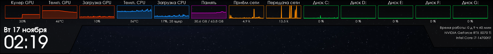

# SK Neon Meters — русская версия

Форк скина **SK Neon Meters** (Stormknight / Yincognito) с русской локализацией и исправленной подстройкой под разрешение экрана.

## Отличия от оригинального скина

**Русский интерфейс**

- Все подписи переведены: «Кулер GPU», «Темп. GPU», «Загрузка GPU», «Темп. CPU», «Загрузка CPU», «Память», «Приём сети», «Передача сети», «Диск C:»…, дата и «Время работы».
- Температура показывается со знаком градуса — `47 °C`.

**Исправлен запуск на втором мониторе**

- Раньше при старте раскладка строилась под ширину основного монитора, поэтому панель и блоки уезжали за правый край, и помочь мог только ручной «Обновить скин». Теперь ширина корректна с первого кадра, без обновления.

**Подстройка под экран**

- Ширина скина задаётся одной переменной `ScreenW` (по умолчанию — рабочая область монитора). При смене монитора или разрешения правится только она.
- При перетаскивании скина на другой монитор ширина панели и блоков пересчитывается автоматически и запоминается.
- Ограничение Rainmeter: при самом переезде скин один раз коротко перерисовывается — геометрию, посчитанную при загрузке, движок сам не пересчитывает. Это осознанный компромисс, а не недоделка.

**Данные**

- Имя видеокарты читается напрямую из реестра (`DriverDesc`) — показывается реальная модель, а не пустое/обобщённое значение.
- Температура CPU берётся через плагин CoreTemp (`MaxTemperature`).

**Техническое**

- Файл скина сохранён в UTF-16 LE с BOM. При сохранении в UTF-8/ANSI кириллица и `°` читаются как cp1251 и превращаются в «кракозябры» — это важно при правках.
- Блоки дисков появляются по факту существования тома (в этой конфигурации — C: … G:).
